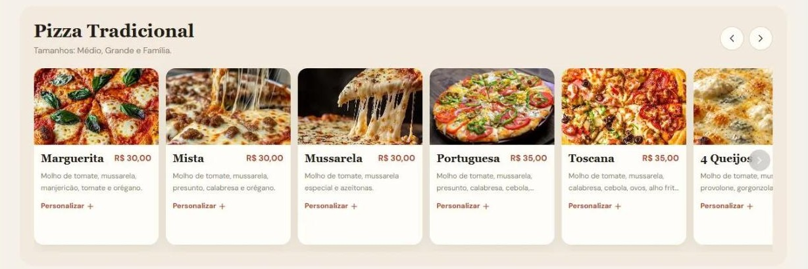
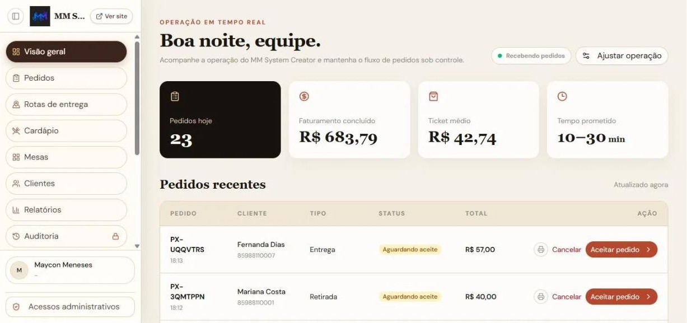
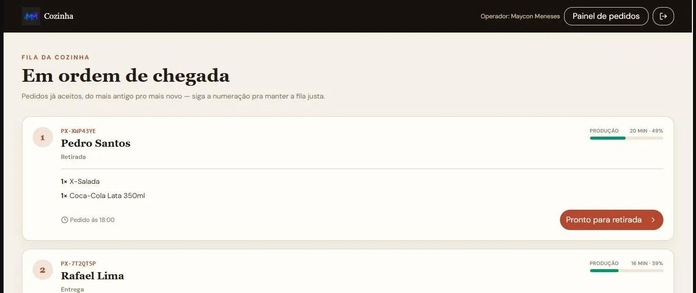

# Comandiva

<!-- portfolio-quick-view:start -->
## Visão rápida para recrutadores | Recruiter overview

**Problema:** restaurantes precisam administrar pedidos e atendimento digital sem depender de um marketplace.  
**Solução:** plataforma própria com cardápio, delivery/retirada, painel operacional, cozinha e atendimento por QR Code.  
**Stack:** React · TypeScript · Node.js · Express · tRPC · MySQL/MariaDB · Drizzle · Docker.

**O que demonstra no código**
- Fluxos completos de pedidos, pagamentos e integrações (incluindo Mercado Pago).
- Separação entre app do restaurante, painel Master e site comercial em um monorepo.
- Autorização por planos e rotinas operacionais; CI configurada para testes, build e migrações com banco real.

**Veja rapidamente:** [capturas de tela](#telas) · [estrutura](#como-o-repositório-está-organizado) · [tecnologias](#tecnologias) · [site comercial](https://mmsystem.tech/comercial).  
**EN:** Full-stack restaurant ordering and management system with a branded storefront, payment integrations, kitchen workflow and operational dashboard.

<!-- portfolio-quick-view:end -->


**Sistema de pedidos para restaurantes, lanchonetes e bares, sem comissão por pedido e com a marca do próprio restaurante.**

O cliente faz o pedido pelo celular, a equipe aceita no painel, a cozinha segue a fila e o dono acompanha o dia em uma tela só. Cada restaurante roda em um ambiente isolado (não é um marketplace compartilhado).

Site comercial: [mmsystem.tech/comercial](https://mmsystem.tech/comercial) (teste grátis de 7 dias, sem cartão de crédito)

## Telas

As imagens abaixo são telas reais do sistema, com dados de demonstração.

**Cardápio digital:** o cliente escolhe pelo que vê, com foto, descrição, preço e personalização do item.



**Visão geral do dono:** pedidos do dia, faturamento, ticket médio e tempo prometido, com os pedidos recentes e o botão de aceitar.



**Fila da cozinha:** pedidos aceitos em ordem de chegada, com o prazo de preparo de cada um.



## O que o sistema faz

**Para o cliente**
- Cardápio digital com fotos, categorias, complementos e promoções.
- Pedido para delivery ou retirada, com validação do endereço contra as rotas de entrega.
- Pagamento por Pix ou cartão online (Mercado Pago Checkout Pro).
- Acompanhamento do pedido pelo telefone.
- Mesa com QR Code: pedir rodadas, chamar o garçom e pedir a conta pelo celular.

**Para a equipe**
- Painel de pedidos em tempo real (aceitar, preparar, entregar) com barra de tempo de preparo e fila da cozinha.
- Comanda digital das mesas, reservas e app instalável (PWA) para celular e tablet.
- Administração de cardápio, promoções, rotas de entrega, clientes, relatórios, equipe, permissões e auditoria.
- Recursos liberados por plano, com bloqueio no backend.

## Como o repositório está organizado

Monorepo com três projetos independentes, cada um com seu `package.json` e seu deploy:

| Pasta | O que é |
|---|---|
| [`Sistema de restaurante/`](Sistema%20de%20restaurante) | App dos restaurantes: cardápio, pedidos, painel, cozinha. Tem README próprio com a arquitetura e o passo a passo para rodar |
| `Master/` | Painel Master: planos, cobrança e licenciamento (Mercado Pago) |
| `Site comercial/` | Páginas de venda, publicadas a partir do Master |

## Tecnologias

React, TypeScript, Tailwind, Node.js, Express, tRPC, MySQL/MariaDB (Drizzle ORM), armazenamento de imagens compatível com S3 (MinIO), Docker e Docker Compose, Mercado Pago.

## Como rodar

Só precisa de Docker. Dentro da pasta do app:

```bash
cd "Sistema de restaurante"
./iniciar.sh
```

O script cria o `.env` com segredos aleatórios, sobe app, banco e storage, aplica as migrations e roda o seed inicial. O site abre em `http://localhost:3000`, e o usuário e a senha do admin aparecem no final. Outras opções (sem Docker, publicação em servidor) estão no README da pasta do app.

## Autor

Criado por **Maycon Meneses**, desenvolvedor Full Stack ([LinkedIn](https://www.linkedin.com/in/maycon-meneses)).
